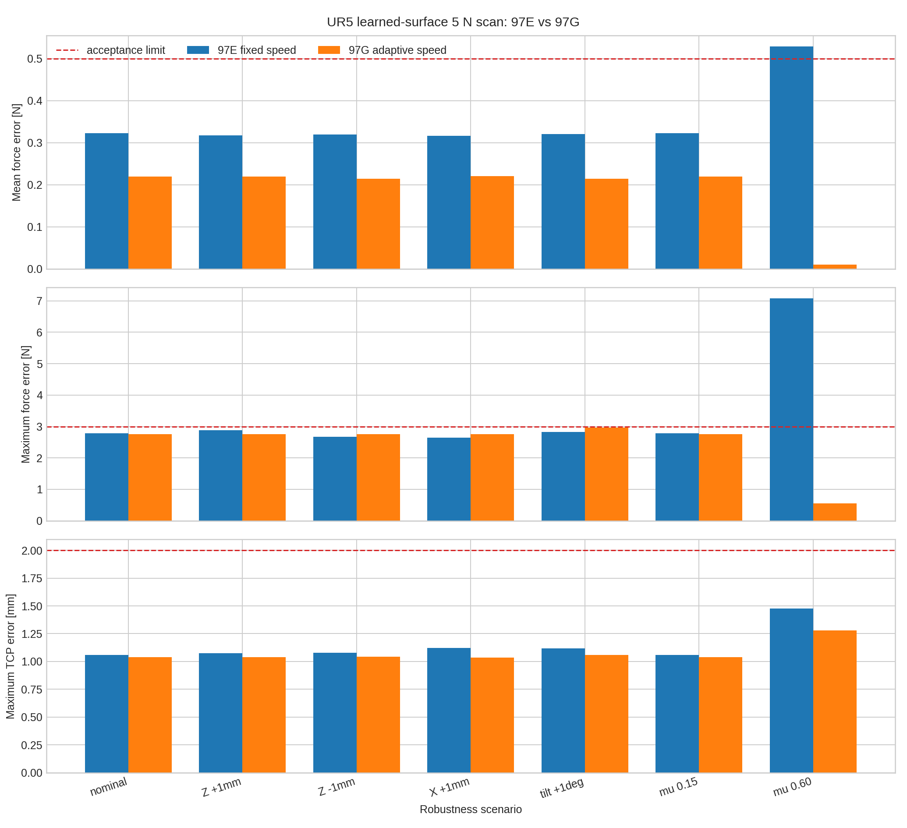
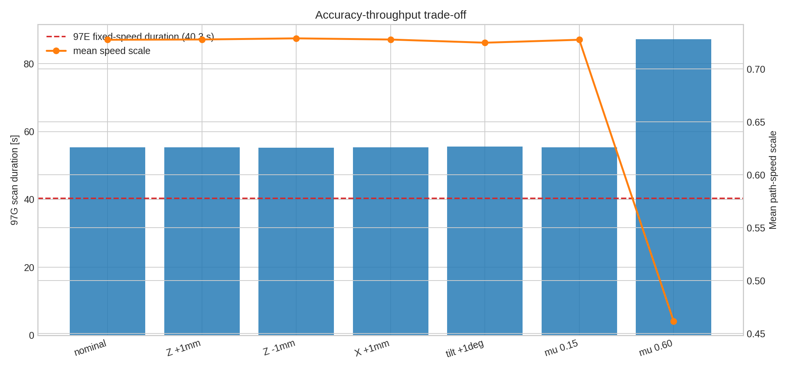

# 97H 固定速度与自适应速度对比

- 97E固定速度通过：6/7。
- 97G自适应速度通过：7/7。
- 高摩擦平均力误差：0.529 → 0.010 N（下降98.2%）。
- 高摩擦最大力误差：7.076 → 0.546 N（下降92.3%）。
- 高摩擦扫描时间：40.286 → 87.260 s。
- 所有场景均无力矩饱和，TCP最大误差均低于2 mm。

结论：改善来自力/摩擦感知的路径时间缩放与更高带宽的法向导纳，不是提高笛卡尔位置PID。代价是困难接触区域降低扫描吞吐率。

